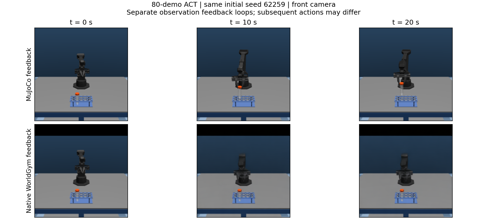

# WorldGym–AutoBio: ACT Training and Native Policy Evaluation

**Train ACT to pick up a centrifuge tube, test whether native WorldGym can evaluate those policies, then compare a latent world model with its own simulator.**

This independent project uses the AutoBio MuJoCo task and WorldGym. The notebooks are the main deliverable: a successful policy-training stage, a native world-model evaluation limitation, and a PickCube latent-model comparison that does not generate future images.

## Read the three notebooks

| Notebook | Main question | Recorded result |
|---|---|---|
| [01 · ACT imitation learning](01_act_imitation_learning.ipynb) | Can ACT learn tube pickup from 10 or 80 demonstrations? | **31/50 and 50/50** on the same Stage 1 test starts |
| [02 · Can Native WorldGym Evaluate Our ACT Policies?](02_worldgym_policy_evaluation.ipynb) | Can generated future observations support evaluation of fixed ACT policies? | On ten shared development starts, MuJoCo feedback gives **8/10 and 10/10**; replaying the actions from the native observation loops gives **0/10 for both** |
| [03 · Can a latent world model be compared with its simulator?](03_latent_pickcube_policy_evaluation.ipynb) | Without generating future images, can one frozen policy be evaluated in a latent model and in its simulator? | On PickCube, simulator official success is **19/20** and the reward proxy is **17/20** |

The second-stage checkpoint is task-adapted WorldGym. Native future camera images come from the video model, not CAD rendering. A separate learned model supplies joint observations.

[10-demo comparison video](media/demos/native_comparison_10demo.mp4) · [80-demo comparison video](media/demos/native_comparison_80demo.mp4)

Each comparison uses the same ACT and initial state, but the two observation loops can produce different later actions. Examples use the smallest shared seed, 62259, with fixed frame times. All twenty numerical cases are bundled.

## Main finding

The policies can perform the task with simulator observations. The current native observation loop does not preserve that behavior. Generated frames show visual and motion-response problems, and the resulting actions fail the physical replay diagnostic. **Reliable native policy evaluation was not established.** Blur alone has not been isolated as the cause.

The next step on the tube task is better action-conditioned prediction and a repeated closed-loop evaluation—not treating world-model RL as already justified. Additional matched target-task trajectories are a possible improvement to test.

Stage 3 is a separate follow-up. On PickCube, in SAPIEN/PhysX, a frozen TD-MPC2 policy reaches **19/20** official successes in the simulator and **17/20** by a predeclared reward proxy. The model predicts latent states rather than camera frames. This does not restore native evaluation of the tube policies, and the PickCube weights are not a MuJoCo tube policy.

## Verify the saved results

Read the saved notebook outputs, or run:

    python -m pip install -r requirements.txt
    python tools/verify_notebooks.py

This checks bundled hashes, per-scene records and all three notebooks in fresh CPU kernels. It does not rerun training or simulation.

GPU entrypoints are in [Scripts/README.md](Scripts/README.md). They reuse the previous portable ACT training/evaluation code. The task checkpoint bundle is **not published**, so a fresh clone supports CPU verification after dependency installation; GPU runs require matching external assets. The portable entries are not a one-command reconstruction of every historical experiment.

## What is in this repository?

- **Three notebooks** with an input → execution → result → next-step narrative.
- **Evidence:** Stage 1 outcomes, all twenty native diagnostics, copied original records, source fingerprints, and the 20 saved PickCube paired trajectories.
- **Media:** one reused Stage 1 teaching image, two actual-frame comparison figures, three tube videos, and the PickCube simulator and latent-rollout clips.
- **Scripts:** existing preparation, ACT SFT and evaluation entrypoints with their dependency closure.
- **Verification:** a small CPU checker and file manifest.

The Stage 1 test, Stage 2 development diagnostic, historical Hybrid test, and Stage 3 PickCube starts are different batches. Stages 1 and 2 concern the simulated tube task. Stage 3 concerns PickCube. None of these results is a real robot or wet-lab deployment.

Separate Hybrid and native RL explorations are retained in the [earlier project](https://github.com/Kevin11Kaikai/worldgym-autobio); they do not substitute for the native evaluation result.

[Source manifest](SOURCE_MANIFEST.json) · [Reuse provenance](BUILD_PROVENANCE.json) · [Attribution](THIRD_PARTY_NOTICES.md)
